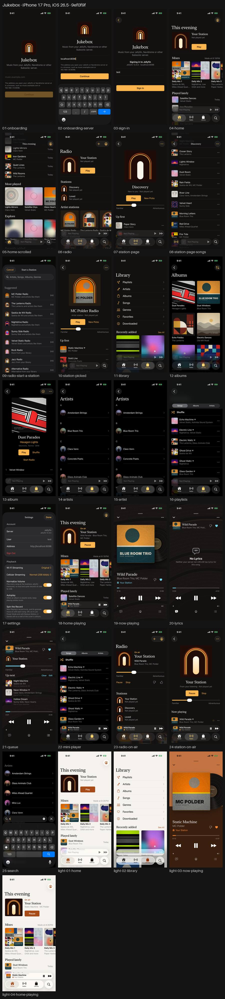
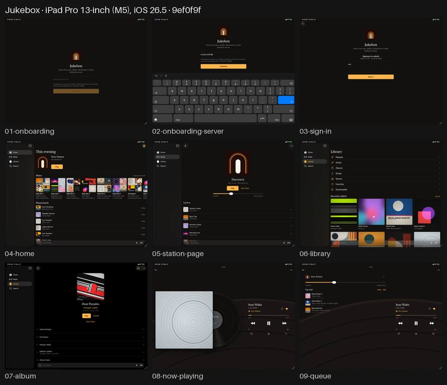

# Jukebox, as it looks

Every main screen of the app, walked in the iOS Simulator on GitHub's Mac against a made-up
Jellyfin library (`dev/fake-jellyfin.py`), by `ci/screenshots.sh` after each push. This branch
holds the latest round only: each round replaces it.

From `9ef0f9f` on `openpanel-stats`, run 60, 2026-11-13 20:39 UTC.

## iPhone

iPhone 17 Pro, iOS 26.5, 29 pictures.
[Every picture](iphone/) · [the sheet at full size](iphone-sheet.png)

- iphone-dark: Passed
- iphone-light: Passed

[](iphone-sheet.png)

Steps that found nothing to tap:

```
iphone-dark: after 15-artist: Library: Playlists: not found within 10 s
```

## iPad

iPad Pro 13-inch (M5), iOS 26.5, 9 pictures.
[Every picture](ipad/) · [the sheet at full size](ipad-sheet.png)

- ipad-dark: Passed

[](ipad-sheet.png)

