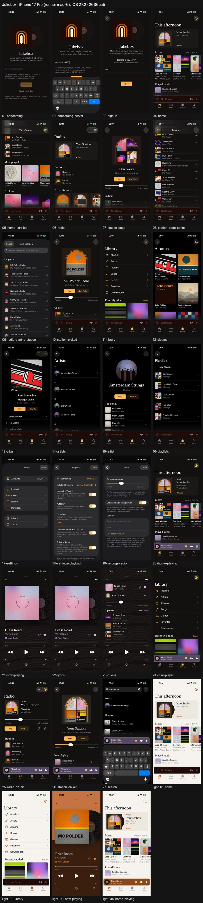
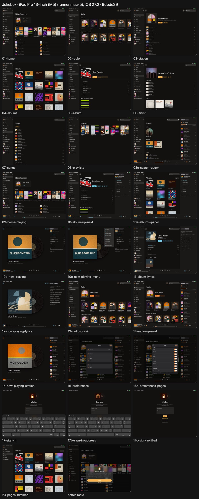
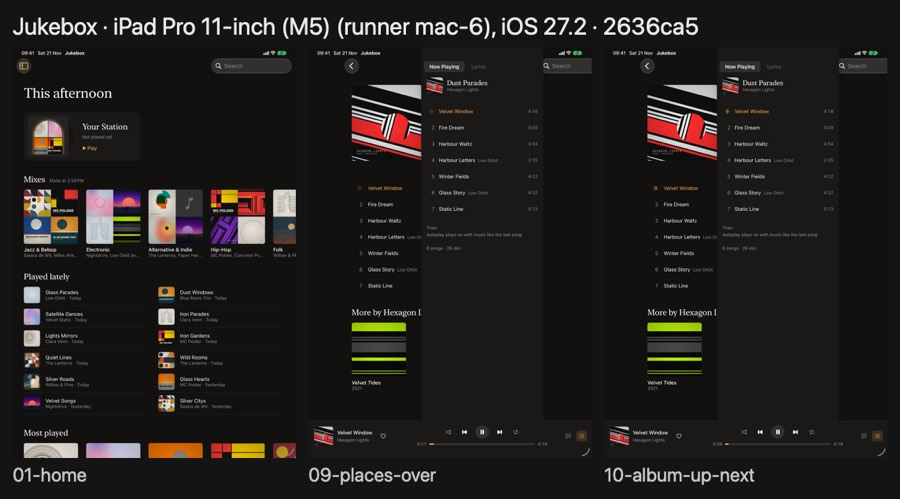

# Jukebox, as it looks

Every main screen of the app, walked in the iOS Simulator on GitHub's runner against a made-up
Jellyfin library (`dev/fake-jellyfin.swift`), by `ci/screenshots.sh` after each push. This branch
holds the latest round of main at its top, and the latest of each work branch in
`branches/<name>/`: each round replaces its own. The iPad's pictures are named as their twins
in Linux's walk (`Linux/App/Shots.swift`, 1440x900; upright, 760x900).

From `9dbde29` on `main`, run 589, 2026-11-26 11:21 UTC.

## runner, drawn offscreen

macOS 27.2, offscreen, 38 pictures.
[Every picture](runner-snap/) · [the sheet at full size](runner-snap-sheet.png)

- runner-snap: 38 pictures in 67 s

## iPhone

iPhone 17 Pro (runner runner-5), iOS 27.2, 39 pictures.
[Every picture](iphone/) · [the sheet at full size](iphone-sheet.png)

- iphone-dark: Passed
- iphone-light: Passed

## iPad

iPad Pro 13-inch (M5) (runner runner-5), iOS 27.2, 26 pictures.
[Every picture](ipad/) · [the sheet at full size](ipad-sheet.png)

- ipad-dark: Passed

## iPad, upright

iPad Pro 11-inch (M5) (runner runner-5), iOS 27.2, 3 pictures.
[Every picture](ipad11/) · [the sheet at full size](ipad11-sheet.png)

- ipad11-dark: Passed

