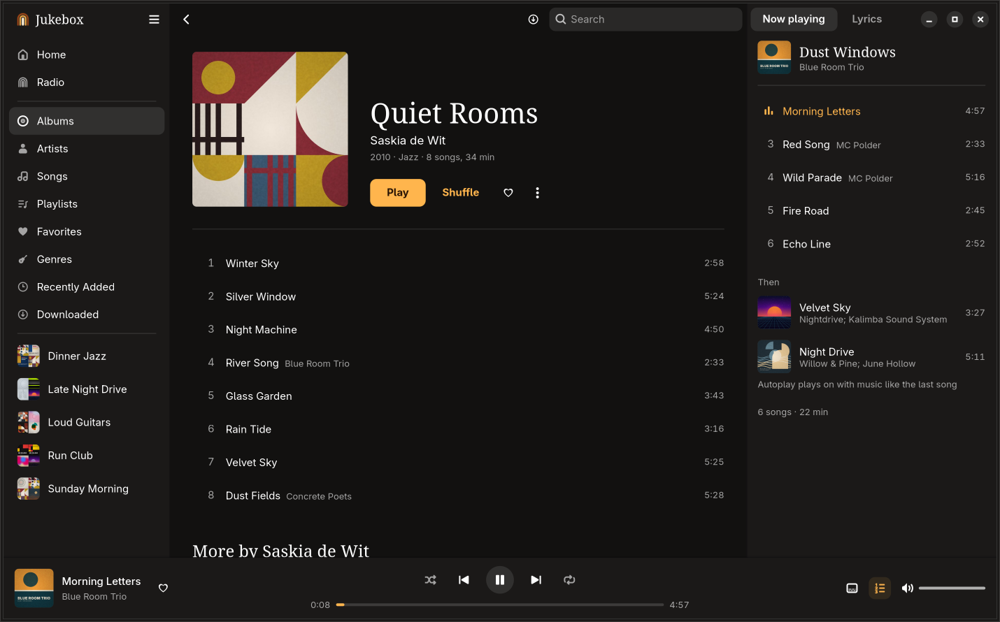
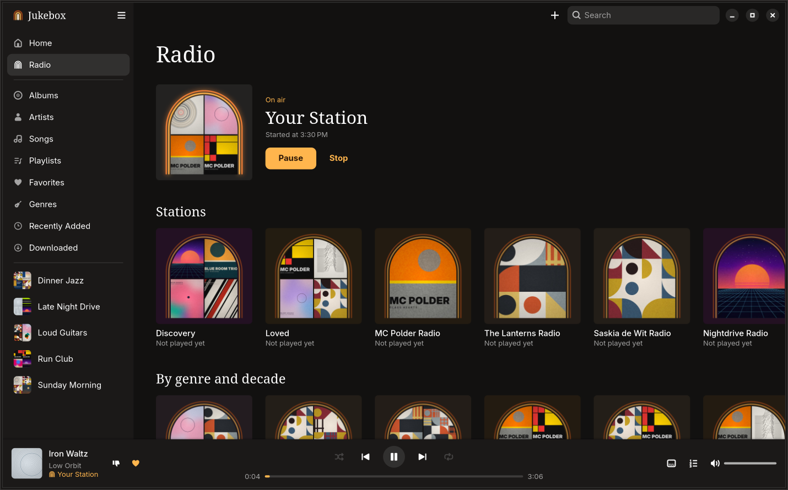
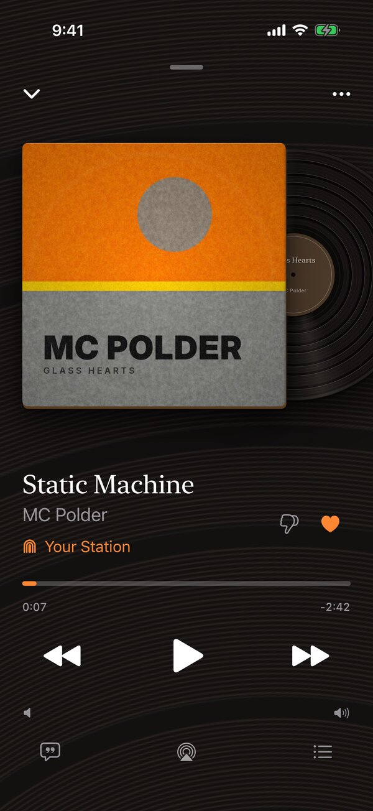

# Jukebox

The music on your Jellyfin, Emby, Plex, Navidrome or other Subsonic server, on the
iPhone, the iPad, the Mac and Linux. Artists, albums, songs and playlists; playlists
Jukebox makes up for you on Home; and a radio that plays on from any song,
artist, album, genre or decade and learns from what you skip.

What plays on one device shows on the other: leave the computer, and the
phone goes on where it was.

Keep more than one account, a home server and a shared one, and switch
between them in Settings or the menu; each keeps its own library, downloads
and radio.

In the car it plays through CarPlay: Home, Radio and the Library on the car's
screen, and Now Playing with the station's thumbs. Siri plays any album,
artist, playlist or station by name ("Play Blue in Jukebox"), and the same
actions are in Shortcuts on the iPhone, the iPad and the Mac.

The iPhone and the iPad need iOS 18 or later, the Mac macOS 15 Sequoia or later.

  

  
  

## Linux

    dev/linux-install.sh

builds Jukebox in Docker and installs it for you (binary, icon, desktop
entry). It needs only libraries (GTK 4, libadwaita, GStreamer, libsecret): at home on GNOME, at
ease on KDE, XFCE and Hyprland. More in `docs/LINUX.md`.

Or the Flatpak, from [Releases](https://github.com/simmmmm/Jukebox/releases):

    flatpak install --user Jukebox-1.0-x86_64.flatpak

Without Flatpak, the AppImage from the same page runs as it is:

    chmod +x Jukebox-1.0-x86_64.AppImage && ./Jukebox-1.0-x86_64.AppImage

## TestFlight

GitHub's macOS runners build and upload it, so no Mac is needed.

1. App Store Connect › Apps › `+` › New App: iOS, name *Jukebox*, bundle ID
   `com.tijmen.Jukebox`, SKU `jukebox`. If the bundle ID is not offered,
   register it under Certificates, Identifiers & Profiles › Identifiers.
2. This repository's secrets (Settings › Secrets and variables › Actions):
   `APPLE_TEAM_ID`, `ASC_KEY_ID`, `ASC_ISSUER_ID`, `ASC_KEY_P8`, the same as
   Numa-mac's: an App Store Connect API key with the Admin role.
3. Actions › CI › Run workflow, with "Upload to TestFlight" ticked, or a
   commit whose message has `[testflight]`. Only main uploads; a work
   branch only builds.

The Mac's app is the same app with the same bundle ID, so it goes to the
same record, one purchase for all three. A `[testflight]` run uploads it
after the iPhone's (`mac_upload=true` in `ci/app.sh`).
`docs/RELEASE.md` has the rest, and the quick loop on the photographer's
Mac.

## Last.fm

The radio asks Last.fm, with Jukebox's own key, which artists and songs
sound alike, and the stations get much better; a build without the key works
from your library alone. Your own free key (last.fm/api/account/create) in
Settings is used instead when set. Only artist names and
song titles are sent to Last.fm.

## Development

See `docs/ARCHITECTURE.md`. `dev/jellyfin-test-server.sh` and
`dev/kit-test.sh` test JukeboxKit on Linux against a real Jellyfin in
Docker.

## Licence

MIT: see `LICENSE`.
