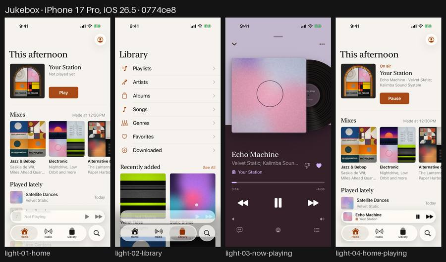
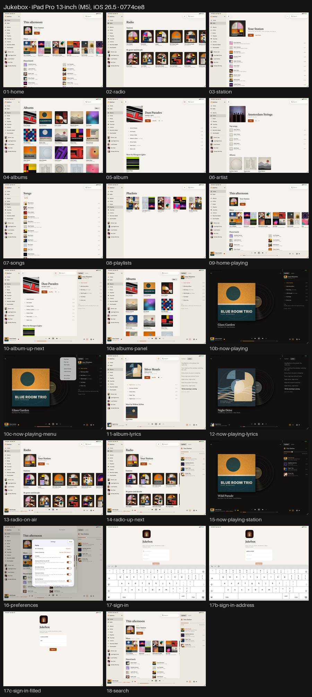

# Jukebox, as it looks

Every main screen of the app, walked in the iOS Simulator on GitHub's Mac against a made-up
Jellyfin library (`dev/fake-jellyfin.py`), by `ci/screenshots.sh` after each push. This branch
holds the latest round of mac and main at its top, and the latest of each work branch in
`branches/<name>/`: each round replaces its own. The iPad's pictures are named as their twins
in Linux's walk (`Linux/App/Shots.swift`, 1440x900; upright, 760x900).

From `0774ce8` on `apple-fixes-walk`, run 135, 2026-11-15 12:54 UTC.

## iPhone

iPhone 17 Pro, iOS 26.5, 4 pictures.
[Every picture](iphone/) · [the sheet at full size](iphone-sheet.png)

- iphone-dark: Failed: Failed to launch <XCUIApplicationImpl: 0x106002440 com.tijmen.Jukebox at /Users/runner/work/Jukebox/Jukebox/build/screenshots/derived/Build/Products/Debug-iphonesimulator/Jukebox.app> via Xcode: Timed out while launching application via Xcode.
- iphone-light: Passed

[](iphone-sheet.png)


## iPad

iPad Pro 13-inch (M5), iOS 26.5, 23 pictures.
[Every picture](ipad/) · [the sheet at full size](ipad-sheet.png)

- ipad-dark: Passed

[](ipad-sheet.png)

Steps that found nothing to tap:

```
ipad-dark: after 16-preferences: skipped: no place.search within 3 s
```

## iPad, upright

iPad Pro 11-inch (M5), iOS 26.5, 0 pictures.
[Every picture](ipad11/) · [the sheet at full size](ipad11-sheet.png)

- ipad11-dark: Failed: Failed to launch <XCUIApplicationImpl: 0x107d41d40 com.tijmen.Jukebox at /Users/runner/work/Jukebox/Jukebox/build/screenshots/derived/Build/Products/Debug-iphonesimulator/Jukebox.app> via Xcode: Timed out while launching application via Xcode.


## Problems in this round

- the ipad simulator did not turn dark
