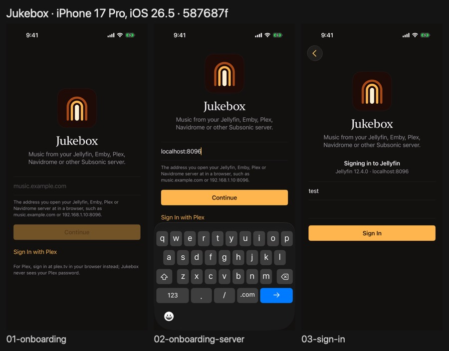
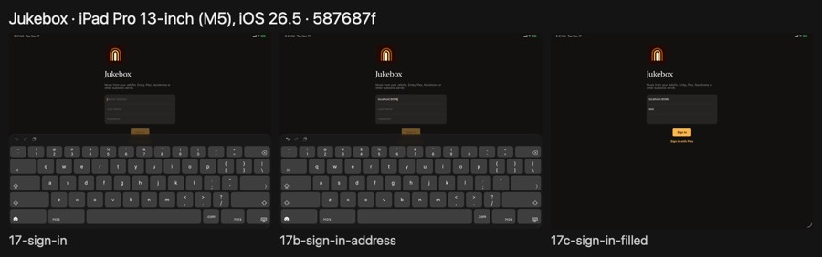

# Jukebox, as it looks

Every main screen of the app, walked in the iOS Simulator on GitHub's Mac against a made-up
Jellyfin library (`dev/fake-jellyfin.swift`), by `ci/screenshots.sh` after each push. This branch
holds the latest round of main at its top, and the latest of each work branch in
`branches/<name>/`: each round replaces its own. The iPad's pictures are named as their twins
in Linux's walk (`Linux/App/Shots.swift`, 1440x900; upright, 760x900).

From `587687f` on `design-polish-walk`, run 233, 2026-11-17 12:27 UTC.

## iPhone

iPhone 17 Pro, iOS 26.5, 3 pictures.
[Every picture](iphone/) · [the sheet at full size](iphone-sheet.png)

- iphone-dark: Failed: failed - Jukebox stopped running at “Sign in: Sign In” (state 1)
- iphone-light: Failed: failed - Jukebox stopped running at “Sign in: Sign In” (state 1)

[](iphone-sheet.png)

Steps that found nothing to tap:

```
iphone-dark: after 03-sign-in: Sign in: Return did not sign in within 45 s
iphone-dark: after 03-sign-in: Sign in: Sign In: not found within 2 s
iphone-dark: after 03-sign-in: Jukebox stopped running at “Sign in: Sign In” (state 1)
iphone-light: after the start: Sign in: Return did not sign in within 45 s
iphone-light: after the start: Sign in: Sign In: not found within 2 s
iphone-light: after the start: Jukebox stopped running at “Sign in: Sign In” (state 1)
```

## iPad

iPad Pro 13-inch (M5), iOS 26.5, 3 pictures.
[Every picture](ipad/) · [the sheet at full size](ipad-sheet.png)

- ipad-dark: Failed: Failed to get matching snapshots: Lost connection to the application (pid 41177). (Underlying Error: Couldn’t communicate with a helper application. Try your operation again. If that fails, quit and relaunch the application and try again. connection to service created from an endpoint)

[](ipad-sheet.png)


## iPad, upright

iPad Pro 11-inch (M5), iOS 26.5, 0 pictures.
[Every picture](ipad11/) · [the sheet at full size](ipad11-sheet.png)

- ipad11-dark: Failed: Failed to get matching snapshots: Lost connection to the application (pid 50381). (Underlying Error: Couldn’t communicate with a helper application. Try your operation again. If that fails, quit and relaunch the application and try again. connection to service with pid 50381 created from an endpoint)

