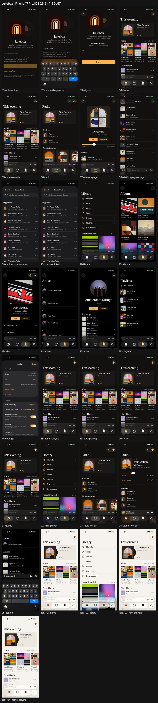
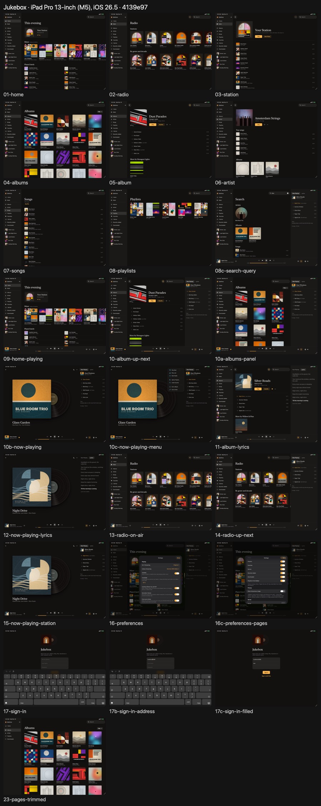
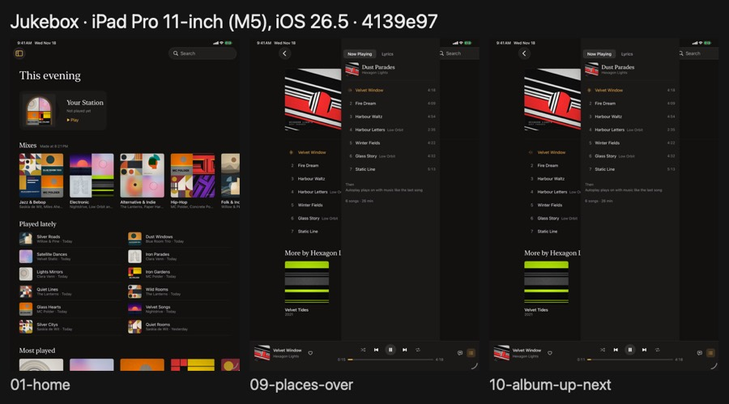

# Jukebox, as it looks

Every main screen of the app, walked in the iOS Simulator on GitHub's Mac against a made-up
Jellyfin library (`dev/fake-jellyfin.swift`), by `ci/screenshots.sh` after each push. This branch
holds the latest round of main at its top, and the latest of each work branch in
`branches/<name>/`: each round replaces its own. The iPad's pictures are named as their twins
in Linux's walk (`Linux/App/Shots.swift`, 1440x900; upright, 760x900).

From `4139e97` on `parity-walk`, run 273, 2026-11-18 20:22 UTC.

## iPhone

iPhone 17 Pro, iOS 26.5, 29 pictures.
[Every picture](iphone/) · [the sheet at full size](iphone-sheet.png)

- iphone-dark: Passed
- iphone-light: Passed

[](iphone-sheet.png)

Steps that found nothing to tap:

```
iphone-dark: after 09-radio-start-a-station: Start a Station: the chosen station's page: not found within 10 s
iphone-dark: after 10-station-picked: back to Radio: the page stayed, back once more
iphone-dark: after 17-settings: Home: Your Station's Play: no enabled Play
iphone-dark: after 18-home-playing: Now Playing did not open, from Home's card nor from the mini player
iphone-dark: after 23-radio-on-air: Radio: the Your Station station's page did not open (no New Picks, no Up Next)
iphone-light: after light-02-library: Home: Your Station's Play: no enabled Play
iphone-light: after light-02-library: Now Playing did not open, from Home's card nor from the mini player
```

## iPad

iPad Pro 13-inch (M5), iOS 26.5, 25 pictures.
[Every picture](ipad/) · [the sheet at full size](ipad-sheet.png)

- ipad-dark: Failed: Failed to get matching snapshots: Timed out while evaluating UI query.
- ipad-dark-again: Passed

[](ipad-sheet.png)

Steps that found nothing to tap:

```
ipad-dark-again: after 12-now-playing-lyrics: Home: Your Station's Play: no enabled Play
```

## iPad, upright

iPad Pro 11-inch (M5), iOS 26.5, 3 pictures.
[Every picture](ipad11/) · [the sheet at full size](ipad11-sheet.png)

- ipad11-dark: Passed

[](ipad11-sheet.png)

