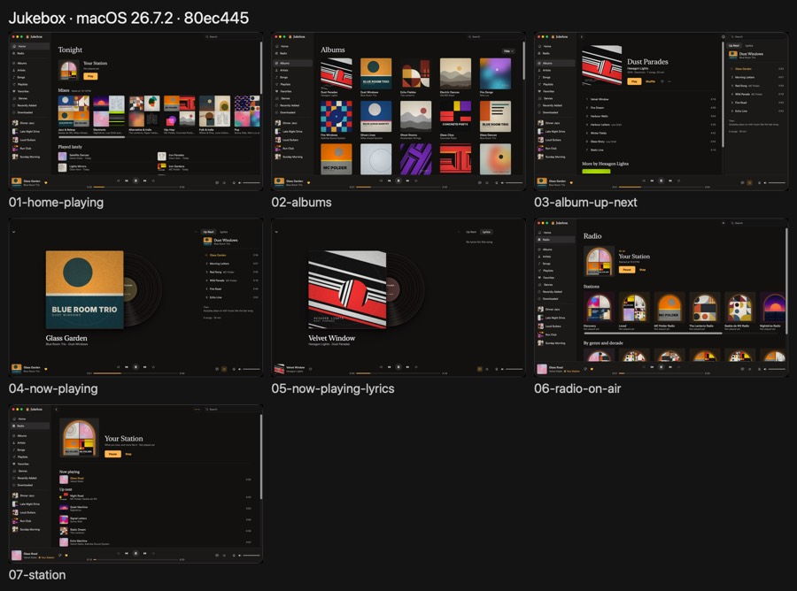

# Jukebox, as it looks

Every main screen of the app, walked in the iOS Simulator on GitHub's Mac against a made-up
Jellyfin library (`dev/fake-jellyfin.swift`), by `ci/screenshots.sh` after each push. This branch
holds the latest round of mac and main at its top, and the latest of each work branch in
`branches/<name>/`: each round replaces its own. The iPad's pictures are named as their twins
in Linux's walk (`Linux/App/Shots.swift`, 1440x900; upright, 760x900).

From `80ec445` on `store-mac-walk`, run 148, 2026-11-15 22:22 UTC.

## Mac

macOS 26.7.2, 7 pictures.
[Every picture](mac/) · [the sheet at full size](mac-sheet.png)

- mac-dark: Passed

[](mac-sheet.png)

Steps that found nothing to tap:

```
mac-dark: after 04-now-playing: Albums: no cover of Silver Roads after thirty scrolls; the first in the window instead
mac-dark: after 04-now-playing: the bar's song was not Night Drive within 15 s
```
