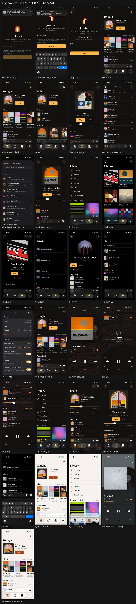
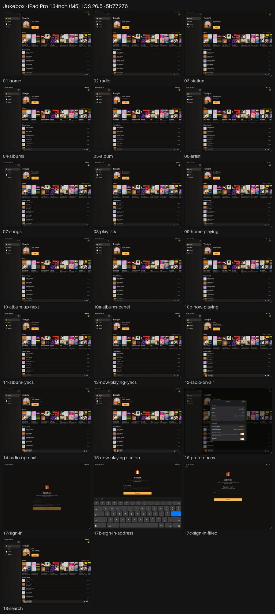
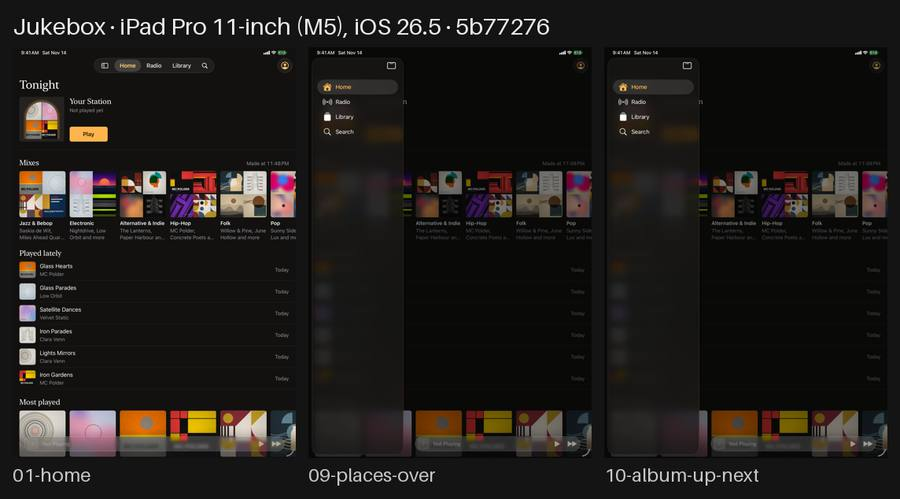

# Jukebox, as it looks

Every main screen of the app, walked in the iOS Simulator on GitHub's Mac against a made-up
Jellyfin library (`dev/fake-jellyfin.py`), by `ci/screenshots.sh` after each push. This branch
holds the latest round of mac and main at its top, and the latest of each work branch in
`branches/<name>/`: each round replaces its own. The iPad's pictures are named as their twins
in Linux's walk (`Linux/App/Shots.swift`, 1440x900; upright, 760x900).

From `5b77276` on `wave-b-walk`, run 100, 2026-11-14 23:50 UTC.

## iPhone

iPhone 17 Pro, iOS 26.5, 29 pictures.
[Every picture](iphone/) · [the sheet at full size](iphone-sheet.png)

- iphone-dark: Passed
- iphone-light: Passed

[](iphone-sheet.png)


## iPad

iPad Pro 13-inch (M5), iOS 26.5, 22 pictures.
[Every picture](ipad/) · [the sheet at full size](ipad-sheet.png)

- ipad-dark: Passed

[](ipad-sheet.png)

Steps that found nothing to tap:

```
ipad-dark: after 01-home: skipped: no place.radio within 3 s
ipad-dark: after 03-station: skipped: no place.albums within 3 s
ipad-dark: after 05-album: skipped: no place.artists within 3 s
ipad-dark: after 06-artist: skipped: no place.songs within 3 s
ipad-dark: after 07-songs: skipped: no place.playlists within 3 s
ipad-dark: after 08-playlists: skipped: no place.albums within 3 s
ipad-dark: after 08-playlists: skipped: no place.home within 3 s
ipad-dark: after 09-home-playing: skipped: no bar.upNext within 4 s
ipad-dark: after 09-home-playing: skipped: no place.albums within 3 s
ipad-dark: after 10-album-up-next: skipped: no bar.song within 4 s
ipad-dark: after 10b-now-playing: skipped: no place.albums within 3 s
ipad-dark: after 10b-now-playing: skipped: no bar.lyrics within 4 s
ipad-dark: after 11-album-lyrics: skipped: no bar.song within 4 s
ipad-dark: after 12-now-playing-lyrics: skipped: no place.home within 3 s
ipad-dark: after 12-now-playing-lyrics: skipped: no place.radio within 3 s
ipad-dark: after 13-radio-on-air: skipped: no bar.upNext within 4 s
ipad-dark: after 14-radio-up-next: skipped: no bar.song within 4 s
ipad-dark: after 15-now-playing-station: skipped: no place.home within 3 s
ipad-dark: after 16-preferences: skipped: no place.search within 3 s
```

## iPad, upright

iPad Pro 11-inch (M5), iOS 26.5, 3 pictures.
[Every picture](ipad11/) · [the sheet at full size](ipad11-sheet.png)

- ipad11-dark: Passed

[](ipad11-sheet.png)

Steps that found nothing to tap:

```
ipad11-dark: after 01-home: skipped: no place.albums within 3 s
ipad11-dark: after 01-home: skipped: no bar.upNext within 4 s
```
